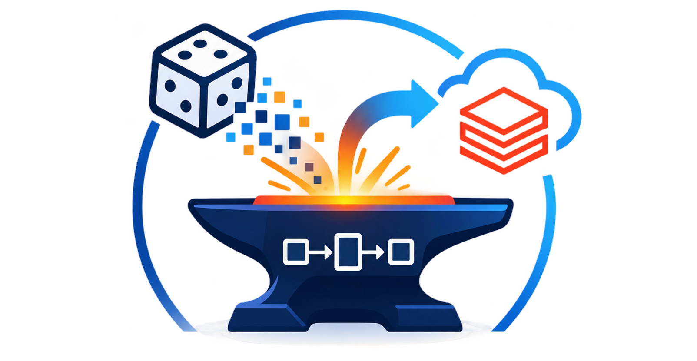

<p align="center">
  
</p>

<h1 align="center">DataForge</h1>

<p align="center">
  <a href="https://github.com/Anetut/data_forge/actions/workflows/ci.yml"></a>
</p>

## Overview

An end-to-end data processing platform for a simulated e-commerce business. It ingests messy data from several sources, cleans and models it with **PySpark + Delta Lake** in a **Bronze / Silver / Gold** (medallion) layout, and serves it to analytics and operational services. It starts fully local and moves to **Azure Databricks + ADLS Gen2** in later phases.

## Planning

- Step 0: Repo foundation, tooling, CI - DONE
- Step 1: Operational database (PostgreSQL), schema design, file formats analysis (CSV/JSON/Parquet) - DONE
- Step 2: Synthetic data generator and ingestion with validation
- Step 3: Batch processing with PySpark
- Step 4: Databricks and Delta Lake: medallion layers, incremental loads, MERGE
- Step 5: End-to-end pipelines: idempotency, retries, orchestration
- Step 6: Azure: ADLS Gen2, Key Vault, monitoring
- Step 7: FastAPI services and business events
- Step 8: Streaming: Event Hubs, Structured Streaming
- Step 9: Production readiness: tests, data quality, CI/CD

## Stack

| Concern | Technology |
| --- | --- |
| Language | Python 3.11+ |
| Operational DB | PostgreSQL 16 (Docker) |
| Data access | psycopg 3, PyArrow (Parquet) |
| Processing | Apache Spark / PySpark |
| Lakehouse | Delta Lake, Azure Databricks, ADLS Gen2 |
| Services | FastAPI, Pydantic |
| Streaming (optional) | Spark Structured Streaming, Azure Event Hubs |
| Quality | Pytest, Ruff, Pyright, GitHub Actions |

## Repository layout

Shared code lives in the installable `dataforge` package under `src/`. Services, Spark jobs and Databricks assets live in top-level directories and import from that package. Dependencies are split into optional extras per Step in `pyproject.toml`.

```
src/dataforge/   Shared Python package (config, logging, ingestion, validation, ...)
services/        FastAPI microservices (Step 7)
spark/           PySpark jobs: bronze / silver / gold (Step 3+)
databricks/      Databricks notebooks, job definitions, bundle config (Step 4+)
sql/             PostgreSQL schema, init scripts and analytical queries
infra/           Azure infrastructure definitions (Step 6)
notebooks/       Local exploration notebooks
data/            Generated datasets (git-ignored)
tests/           Unit and integration tests
docs/            Decisions, SQL schema and diagrams, images
```

## Getting started (Windows / PowerShell)

```powershell
python -m venv .venv
.venv\Scripts\Activate.ps1
pip install -e ".[dev,ingest]"

copy .env.example .env
docker compose up -d postgres

ruff check .
pyright
pytest
```

Scripts in `sql/init/` run only when the Postgres volume is empty. After changing them, recreate the database (this deletes local data):

```powershell
docker compose down -v
docker compose up -d postgres
```

Later steps add extras: `pip install -e ".[dev,spark]"` (Step 3) and `".[dev,services]"` (Step 7).

### Synthetic data

```powershell
python -m dataforge.generator seed       # empty database: reference data + 2 years of orders
python -m dataforge.generator activity   # one run of changes: status updates, new and late orders, deletes
python -m dataforge.generator feed       # partner JSON Lines feed in data/feeds/, with a manifest of injected issues
```

`--seed` fixes the randomness; dates are relative to today. Integration tests run against the same database and roll back: `pytest -m integration`.

### Prerequisites

- Python 3.11+ (3.12 matches current Databricks runtimes best)
- Docker Desktop
- Git
- **Java 17 or 21** from Step 3 on (needed by Spark; newer JDKs may not be supported by the pinned PySpark version). If a newer JDK is first on your `PATH`, point Spark at 21 for the current shell:
  ```powershell
  $env:JAVA_HOME = "C:\Program Files\Eclipse Adoptium\<your jdk-21 folder>"
  ```

## Documentation

- [SQL Schema](docs/sql-schema.md)
- [Decision records](docs/decisions.md)
