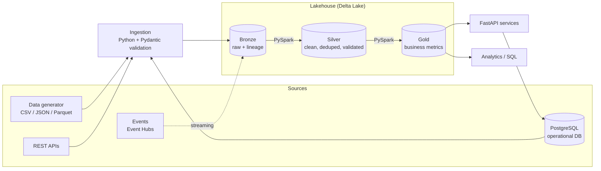

# Architecture (draft)

> Draft. It will be revised as the design is reviewed, with each change recorded as an [ADR](decisions/).

## Data flow

## Layers

| Layer | Purpose | Key problems it solves |
| --- | --- | --- |
| Bronze | Raw data as received, plus ingestion timestamp and source | Replayability, auditing, no data loss |
| Silver | Cleaned, deduplicated, validated, conformed | Data quality, updates, late-arriving data |
| Gold | Aggregated, business-ready tables | Fast, simple consumption |

## Components

To be filled in as each is built. Placeholder for each: responsibility, inputs/outputs, owner module, failure modes.

## Local vs. Azure

| Concern | Local | Azure |
| --- | --- | --- |
| Object storage | `data/` directory | ADLS Gen2 |
| Processing | local PySpark | Azure Databricks |
| Secrets | `.env` | Key Vault |
| Orchestration | scripts | Databricks Workflows / ADF |
| Events | local stand-in | Event Hubs |
