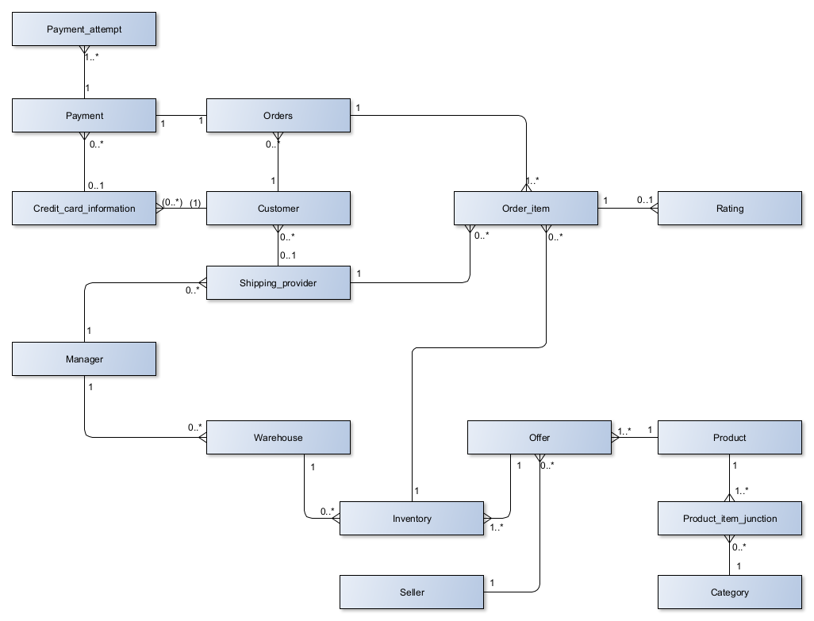

# E-Commerce Schema Design

## Entity relationship diagram

## Entities

### 1. Manager
**Purpose**: Person responsible for a physical location or external contract.

**Attributes**:
- id (primary key)
- name
- phone_number
- email
- hire_date
- contract_due_date
- created_at
- updated_at

### 2. Shipping_provider
**Purpose**: Holds information about shipping providers available

**Attributes**:
- id (primary key)
- manager_id (foreign key)
- name
- phone_number
- address
- cost_per_shipment
- working_hours
- created_at
- updated_at

### 3. Customer
**Purpose**: Core entity for every customer in the system.

**Attributes**:
- id (primary key)
- favourite_shipping_provider_id (OPTIONAL) (foreign key)
- email (unique)
- name
- phone_number
- address
- billing_address
- preferred_payment_method (Cash, Card, Transfer)
- created_at
- updated_at

**Why these**: Email identifies a customer uniquely; timestamps let us audit changes.

### 4. Credit_card_information
**Purpose**: Holds information about saved cards for a customer's account. A customer can have a credit card saved as favourite.

**Attributes**:
- id (primary_key)
- customer_id (foreign key)
- card_token (from payment provider)
- is_favourite
- card_type
- created_at
- updated_at

### 5. Orders
**Purpose**: Order placed in app by customer

**Attributes**:
- id (primary key)
- customer_id (foreign key)
- created_at
- updated_at

### 6. Warehouse
**Purpose**: Physical location from which items are shipped

**Attributes**:
- id (primary key)
- manager_id (foreign key)
- name
- location
- capacity
- created_at
- updated_at

### 7. Seller
**Purpose**: A seller listing products on the platform

**Attributes**:
- id (primary key)
- name
- description
- created_at
- updated_at

### 8. Product
**Purpose**: Information about product sold

**Attributes**:
- id (primary key)
- name
- description
- weight
- expiration_date
- size (OPTIONAL)
- colour (OPTIONAL)
- manufacturer
- produced_at
- created_at
- updated_at

### 9. Category
**Purpose**: Information about product categories

**Attributes**:
- id (primary key)
- name
- description
- created_at
- updated_at

### 10. Product_item_junction
**Purpose**: Links products with categories as many products can be part of many categories

**Attributes**:
- id (primary key)
- product_id (foreign key)
- category_id (foreign key)

### 11. Offer
**Purpose**: What a seller lists with which price since multiple sellers can have the same item at different prices, locations and different specifications. Each size/colour combination is a separate product, variants will be added later

**Attributes**:
- id (primary key)
- seller_id (foreign key)
- product_id (foreign key)
- price
- discount_pct (whole percent, 0 = no discount)
- description
- created_at
- updated_at

### 12. Inventory
**Purpose**: Inventory is the link between the physical warehouse and offer. Acts like a junction

**Attributes**:
- id (primary key)
- warehouse_id (foreign key)
- offer_id (foreign key)
- stock
- created_at
- updated_at

### 13. Order Item (junction)
**Purpose**: Links many orders with inventory rows

**Attributes**:
- id (primary key)
- order_id (foreign key)
- inventory_id (foreign key)
- shipping_provider_id (foreign key)
- price_at_the_time (unit list price at order time)
- discount_pct_at_the_time
- order_status
- quantity
- shipped_at
- delivered_at
- created_at
- updated_at

### 14. Rating
**Purpose**: A customer's rating of a purchased order item. Product and seller averages are computed from these rows.

**Attributes**:
- id (primary key)
- order_item_id (foreign key)
- star_value

### 15. Payment
**Purpose**: Holds information about payment. A payment can be done without a card.

**Attributes**:
- id (primary key)
- credit_card_information_id (foreign key) OPTIONAL
- order_id (foreign key) UNIQUE
- payment_method (Cash, Card, Transfer)
- amount
- created_at
- updated_at

### 16. Payment_attempt
**Purpose**: An order needs to be paid for exactly one time, but the payment can fail due to different reasons

**Attributes**:
- id (primary key)
- payment_id (foreign key)
- status ('Pending', 'In Progress', 'Confirmed', 'Failed')
- created_at
- updated_at

## Business rules

### Orders and payments
- An order has exactly one payment (`payment.order_id` is unique). A payment can fail and be retried; every try is a row in `payment_attempt`. The payment has no status of its own, so an order counts as paid once one of its attempts is `Confirmed`.
- `payment_method` is Cash, Card or Transfer. Only card payments reference a saved card; `credit_card_information_id` is null otherwise.
- A customer can save several cards and mark one as favourite.

### Fulfilment
- An order contains one or more order items. Each order item is fulfilled from one inventory row (an offer stocked in a specific warehouse), so items of the same order can ship from different warehouses.
- Every order item has exactly one shipping provider, selected before checkout, and its own status and shipping timestamps (`shipped_at`, `delivered_at`). Items of the same order can ship and arrive independently.
- `price_at_the_time` (unit list price) and `discount_pct_at_the_time` are copied from the offer when the order item is created, so later offer price or discount changes do not alter past orders. Amount paid for an item = `price_at_the_time * (100 - discount_pct_at_the_time) / 100 * quantity`.

### Catalog and offers
- A product describes the item itself (name, description, weight, ...). What is sold, by whom and at which price is an offer: several sellers can offer the same product at different prices.
- An offer exists independently of any purchase, so customers can see price and availability before ordering.
- Each size/colour combination is a separate product. Product variants may be introduced later.
- Every product belongs to at least one category; "Other" is the fallback. A category may be empty.

### Ratings
- A rating belongs to an order item, so only purchased items can be rated. `star_value` is a whole number from 1 to 5. An order item has at most one rating, and a rating cannot be changed once given.
- Seller and product ratings are not stored; they are derived through `order_item` → `inventory` → `offer`. Each order item maps to exactly one offer, so the seller and product of a rating are unambiguous.

### Inventory and warehouses
- Stock is tracked per offer and warehouse in `inventory`; each (offer, warehouse) pair appears once.
- Warehouses are shared facilities and are not owned by a seller. Which warehouses a seller uses is derived from its offers' inventory rows.
- A manager is responsible for a warehouse or a shipping provider contract.

### Security and scope
- Authentication is handled by an external identity provider; credentials are never stored in this database.
- Only payment-provider tokens are stored for cards; card numbers and CVV are never stored.
- Sellers are linked to orders through offers only. Payment data is not linked to sellers, and seller payouts are out of scope for now.
